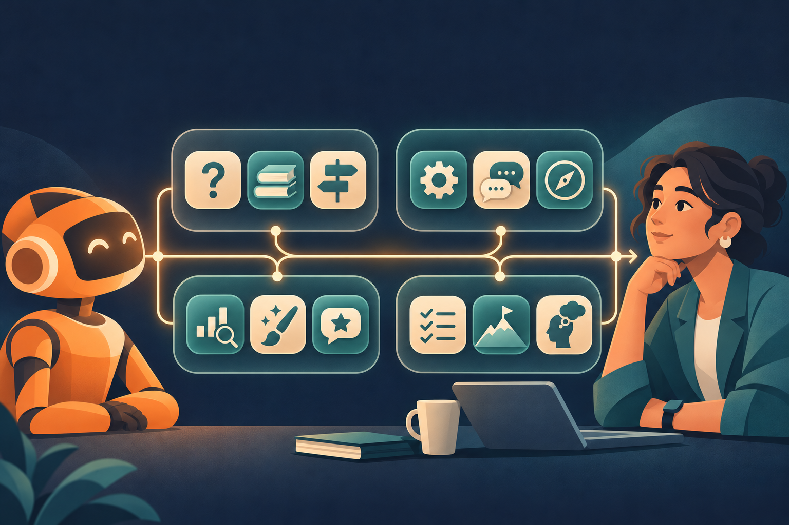

# Twelve Ways Humans and AI Develop a Conversation



### The same AI response can have a different meaning depending on what Human and AI are doing together.

AI conversations are often described as question-and-answer exchanges.

That description is too narrow.

When we work with AI, we may be learning, discussing, exploring, analyzing, creating, reviewing, challenging, or reflecting. Those interactions do not produce the same kind of content—even when they happen inside the same chat.

Suppose AI says:

> This approach has three major risks.

That sentence could be:

- an answer to a direct question;
- part of an explanation;
- a reason behind a recommendation;
- a finding in a review;
- or an unverified lead supporting another task.

The words are the same.

Their status and future use are not.

I find it useful to classify AI conversations by the roles Human and AI are playing and the relationship between them. From that perspective, twelve forms appear.

---

## A. Human Receives Content from AI

### 1. Inquiry

**Human:** questioner  
**AI:** answerer

Inquiry seeks a bounded answer, definition, command, clarification, or fact.

It produces questions, answers, qualifications, and follow-up questions. The record can later become a personal FAQ, answer index, or operational reference.

But receiving an answer is not the same as building understanding.

### 2. Learning

**Human:** learner  
**AI:** teacher or explainer

Learning seeks a change in the Human's mental model.

It produces explanations, examples, misunderstandings, corrections, and questions that reveal what remains unclear. The record can become learning notes, review questions, or a map of knowledge gaps.

### 3. Advisory

**Human:** decision-maker  
**AI:** advisor

Advisory conversations compare alternatives under conditions.

They produce options, trade-offs, risks, assumptions, and reasons for a recommendation. The record can support a decision matrix or later review of whether the adopted recommendation worked.

AI may advise. Human still owns the decision.

### 4. Assistance

**Human:** primary worker  
**AI:** supporting researcher or checker

Assistance serves another task.

AI may locate possible sources, compare definitions, check a calculation, or identify missing information. The output may be a lead rather than a verified result.

The record should preserve what was requested, why it mattered, what was checked, and what remains unverified.

---

## B. Human and AI Develop Content Together

### 5. Discussion

**Human and AI:** conversation partners

Discussion develops viewpoints around an identifiable topic.

It produces agreements, disagreements, distinctions, and branches. The record can support continued discussion or show how a position changed.

### 6. Exploration

**Human and AI:** problem explorers

Exploration may begin before the problem is clearly defined.

It produces hypotheses, possible directions, new questions, and unexpected connections. The record can become a research-question list, an idea backlog, or several new topics.

Discussion develops positions about a topic. Exploration may still be discovering what the topic should be.

### 7. Analysis

**Human:** problem and condition definer  
**AI:** analyst

Analysis develops a judgment from conditions, assumptions, criteria, evidence, and alternatives.

Its reusable value is not only the conclusion. It is the basis of the conclusion. A record makes it possible to revisit the judgment when an assumption or condition changes.

### 8. Creation

**Human:** initiator and direction owner  
**AI:** co-creator or producer

Creation develops an artifact: an article, design, specification, presentation, name, or product concept.

The conversation may contain structures, drafts, rejected titles, alternatives, and revision instructions. That material can support future versions and other outputs.

A process record can show how Human and AI interacted. It does not automatically prove legal authorship or originality.

---

## C. AI Evaluates or Challenges Human Work

### 9. Critique

**Human:** presents an idea or artifact  
**AI:** critic

Critique evaluates qualities such as clarity, coherence, persuasiveness, audience fit, strengths, and weaknesses.

It produces evaluation criteria and improvement directions.

### 10. Review

**Human:** submits and decides how to correct  
**AI:** inspector

Review checks an artifact against requirements, rules, or acceptance conditions.

It produces findings, affected areas, violated expectations, requested corrections, and status. Those findings can become issues or checklist items.

Critique asks how well something works. Review asks whether it satisfies defined expectations.

### 11. Dialectic

**Human:** claimant or questioner  
**AI:** opponent or challenger

Dialectic tests a claim through counterarguments and counterexamples.

It produces hidden assumptions, failure conditions, and revised claims. Its value comes from the exchange, not from one isolated response.

---

## D. AI Helps Human Look Back

### 12. Reflection

**Human:** reviews experience and thinking  
**AI:** reflection partner

Reflection examines what the Human believed, what changed, why a decision was made, and what remains unresolved.

It can become a retrospective, learning review, journal entry, or future decision principle.

The record is a mirror for Human judgment, not an AI verdict about what the Human “really thinks.”

---

## One Chat Can Contain Several Forms

These forms are not mutually exclusive labels for an entire session.

A conversation may move through:

```text
Inquiry
→ Discussion
→ Exploration
→ Analysis
→ Creation
→ Critique
→ Review
→ Reflection
```

Verification, revision, organization, and simulation can also occur across several forms. They are often better understood as activities within the dominant relationship.

For example:

```text
Primary form: Assistance
Activity: Verification

Primary form: Creation
Activity: Revision
```

## The Difficult Part Is Distinguishing Neighboring Forms

The twelve forms are most useful when they help us make a practical distinction. Several pairs can look similar on the surface while producing records with very different meanings.

### Inquiry or Learning?

Both may contain questions and explanations.

In Inquiry, the answer is normally the destination. If I ask which command lists the changed files in Git, a correct command may complete the interaction.

In Learning, the answer is part of a change in understanding. I may need to know what the working tree is, why staged and unstaged changes differ, and how to interpret the result. The reusable material is not merely the command. It includes the explanation, examples, misunderstandings, and correction of those misunderstandings.

### Advisory or Assistance?

An advisor helps a Human choose. An assistant helps a Human perform work whose direction is already substantially owned by the Human.

“Which deployment option should we select under these constraints?” is Advisory.

“Find the documented limits of these three deployment options so I can compare them” is Assistance.

The first record should preserve alternatives, trade-offs, and decision reasoning. The second should preserve queries, sources, checks, and uncertainty. Treating assistance as advice can accidentally give an unverified research lead the status of a recommendation.

### Discussion or Exploration?

Discussion has a recognizable subject and develops positions around it. Exploration may still be discovering the useful questions, boundaries, or problem definition.

A discussion record is valuable because it shows agreements, disagreements, and changes in position. An exploration record is valuable because it preserves branches that did not become the main path. Those abandoned branches may later become separate research topics.

### Analysis or Creation?

Analysis produces a judgment from evidence, criteria, assumptions, and alternatives. Creation produces an artifact.

The distinction matters when AI turns an analysis request into a polished proposal. The proposal may be useful, but polished prose can hide the basis of the judgment. If the intended mode was Analysis, the record should retain the criteria and reasoning before a new artifact is produced.

### Critique, Review, or Dialectic?

These three forms all involve evaluation, but they ask different questions.

- Critique: How well does this work, and how could it work better?
- Review: Does this meet the stated requirements or acceptance conditions?
- Dialectic: Under what counterexample or condition does this claim fail?

A critique can remain partly interpretive. A review needs traceability to a rule or expectation. A dialectical exchange must retain the claim, challenge, response, and revision together; extracting only AI's objection would remove the development that gives the conversation value.

## The Same Project Can Need Several Records

Imagine a Human considering whether to introduce an AI review step into a publishing workflow.

The work might begin with Inquiry: “What is the difference between critique and requirements-based review?”

It might continue as Learning, using examples to build a clearer mental model. Advisory could then compare alternative workflows. Assistance could collect relevant platform rules. Discussion could expose different editorial viewpoints. Exploration could discover that provenance is a separate problem. Analysis could compare the workflows against cost, risk, and turnaround time.

After a decision, Creation could produce the operating guide. Critique could test whether the guide is clear for editors. Review could check it against the approved requirements. Dialectic could attack the claim that the added step always improves quality. Reflection could examine what the team learned after using it.

This is one project, but the content does not all have one evidentiary status. A brainstorm is not a decision. A recommendation is not an approval. A generated draft is not a verified specification. A reflection is not an objective audit.

Recording by topic keeps the continuity. Identifying the conversation form preserves the meaning of each part.

## A Practical Reuse Map

The form helps determine what to extract, which tools may be useful, and what value the next artifact can provide.

| Form | Preserve from the conversation | Possible next tool or artifact | Reuse value |
|---|---|---|---|
| Inquiry | Question, answer, qualification | Searchable notes or FAQ | Faster retrieval |
| Learning | Explanations, examples, confusion, correction | Study guide or flashcards | Retained understanding |
| Advisory | Options, constraints, trade-offs, assumptions | Decision matrix or ADR | Accountable choice |
| Assistance | Query, sources, checks, uncertainty | Research log or evidence table | Verifiable support |
| Discussion | Positions, agreements, disagreements | Viewpoint map or meeting brief | Continued deliberation |
| Exploration | Hypotheses, branches, open questions | Idea backlog or research plan | New directions |
| Analysis | Criteria, evidence, assumptions, reasoning | Comparison model or report | Revisable judgment |
| Creation | Brief, alternatives, drafts, revisions | Article, design, specification, or code | Usable artifact |
| Critique | Criteria, strengths, weaknesses | Improvement plan | Better quality |
| Review | Requirement, finding, affected area, status | Checklist, issue tracker, or report | Compliance and correction |
| Dialectic | Claim, counterexample, response, revised claim | Argument map or risk scenario | More robust reasoning |
| Reflection | Experience, change, unresolved question | Retrospective or journal | Learning across time |

Tools do not have to be elaborate. Markdown may be enough for continuity. A spreadsheet can support comparisons. A citation manager can preserve sources. An issue tracker can carry review findings into action. A version-control system can retain the resulting artifacts and revisions.

The important step is not selecting the most sophisticated tool. It is avoiding a transformation that gives the source conversation more authority than it earned.

---

## Why the Form Matters After the Chat

Each form produces a different reuse path:

```text
Inquiry → FAQ
Learning → study notes
Advisory → decision record
Assistance → verification trail
Discussion → viewpoint map
Exploration → research questions
Analysis → model or comparison
Creation → formal artifact
Critique → improvement plan
Review → issues and status
Dialectic → stronger claim
Reflection → retrospective
```

This is also why chat history is not enough for every use case.

Chat history remembers the session. Reuse depends on understanding which parts of the interaction still matter and what they can become.

Topic Chat Recorder can preserve selected user and assistant messages with basic session metadata in portable Markdown. It does not automatically classify these twelve forms, verify AI answers, build a knowledge base, or prove authorship.

Classification remains a Human tool for deciding what is worth preserving and how to use it next.

> **The value of an AI conversation depends not only on what was said, but on what Human and AI were doing together.**

#ArtificialIntelligence #AIAssistants #KnowledgeManagement #HumanAI #Productivity
