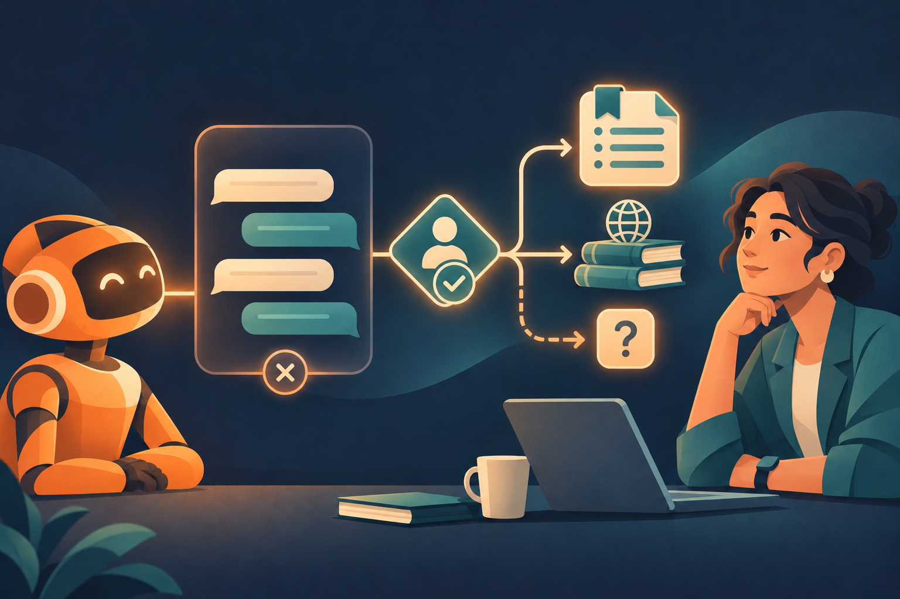

An AI answer includes a convincing claim and a link.

It is copied into your notes. Months later, the note looks like verified research—even though nobody checked whether the source supported the claim.

Exporting a conversation to Markdown solves one problem: the material can leave the original chat interface.

It does not automatically answer:

- Which statements matter?
- Which claims are verified?
- Which branches deserve separate Topics?
- How does this connect to existing knowledge?
- What should become a note, decision, issue, or article?

A chat export is not yet a knowledge base, and an AI answer is not automatically a verified source.

Different tools have different jobs:

```text
Topic recorder → preserves the selected conversation
Obsidian       → connects maintained notes
NotebookLM     → examines a selected source set
Zotero         → manages external publications
Issue tracker  → manages actionable findings
Git            → versions formal artifacts
```

The Topic record can preserve why a question was asked, what AI suggested, which interpretation influenced the work, and what remained uncertain.

The source manager should preserve the actual publication, author, date, and what the primary source supports.

A citation to the chat only proves that a statement appeared in the conversation. It does not prove that the statement is true.

That is why uncertainty should remain visible:

```text
Verified
Partially supported
Source lead only
Unverified
Contradicted
```

Keep the raw conversation record distinct from the maintained knowledge note. One shows what was discussed. The other shows what the Human currently accepts, understands, or has verified.

Capture is not organization. Organization is not verification. Verification is not reuse.

Research provenance is the path from question, to lead, to source, to Human judgment.

How does your team stop plausible AI answers from quietly becoming “verified knowledge”?

#ArtificialIntelligence #Research #KnowledgeManagement #InformationLiteracy
