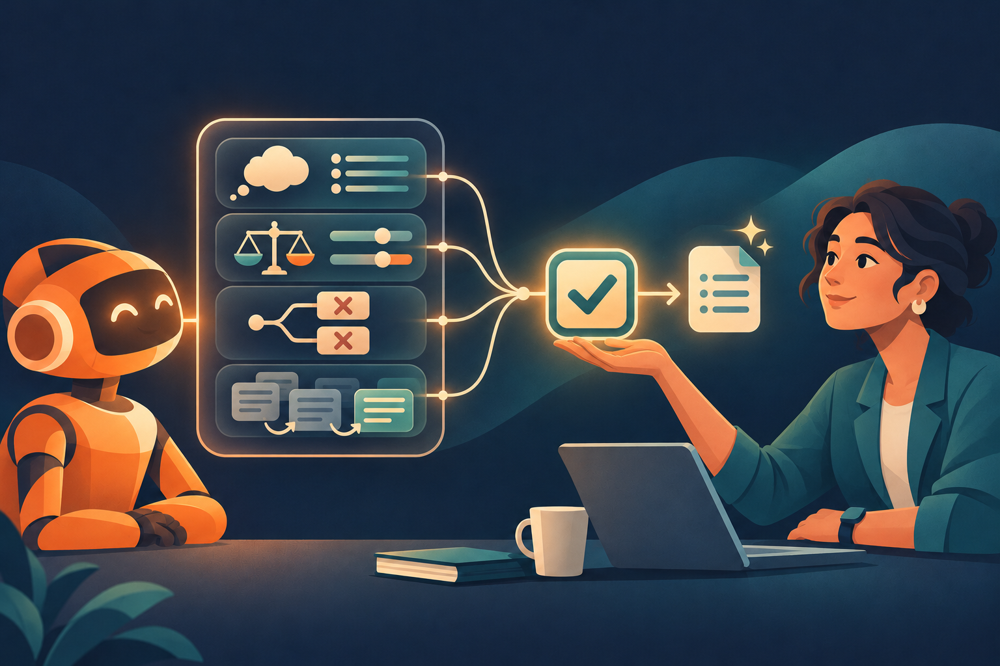

Six months after a decision, the team can find the final document.

Nobody can explain why that option was chosen—or whether the original conditions still apply.

“Choose option B” may have been reasonable because the budget was limited, delivery was required in three months, the team had a particular skill set, one risk was unacceptable, and one source was still missing.

Without those conditions, a conditional judgment begins to look like a permanent preference.

AI analysis and advisory conversations may preserve:

- the decision question;
- alternatives considered;
- evaluation criteria;
- assumptions and constraints;
- benefits and risks;
- missing evidence;
- AI recommendations;
- and Human acceptance or rejection.

That material can support a maintained decision matrix or ADR. The conversation remains supporting context for how ambiguous criteria and trade-offs were handled.

The same principle applies to creative work.

A final draft does not show which title was rejected, which analogy failed, which audience changed the structure, which critique caused a rewrite, or which unused branch may still be valuable.

One recorded Topic can support several later artifacts:

```text
Core idea
├── Medium story
├── LinkedIn post
├── X post
├── presentation
└── future article branch
```

The record is shared source material, not a universal final draft. Each output still needs its own audience, structure, and purpose.

A process record also does not automatically prove legal authorship, independent originality, or ownership. Its practical value is that it preserves alternatives, decisions, revisions, and reasoning that the final artifact no longer shows.

The final decision or draft is the result.

The conversation preserves the conditions and paths needed to revisit it.

How does your team preserve the reasoning behind decisions and drafts—not only their final form?

#ArtificialIntelligence #DecisionMaking #ContentCreation #KnowledgeManagement
