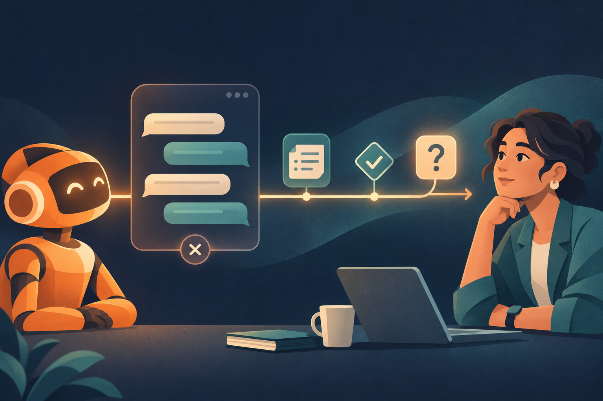

# Your AI Conversation Ended. Its Topics Did Not.



> Chat history remembers where a conversation happened. It does not necessarily preserve what still needs to happen next.

I recently started a conversation with a simple question: what kinds of conversations do people have with AI?

The first answer was a list. Learning. Discussion. Analysis. Critique. Advice. Review. Assistance. Inquiry.

That could have been the end of the chat.

Instead, the question changed.

If those conversations produce different kinds of content, why should they be recorded in the same way? What could be reused later? Which tools would be useful after export? How should the idea be explained in a product page? How many articles would it take to develop the argument properly?

One question became a classification model, a product position, a reuse workflow, a Capafy description, and a cross-platform publishing plan.

The chat was one session.

The work was not.

---

## Chat History Organizes the Container

Most AI products preserve conversations as chats or sessions. That is a reasonable interface. A session has a start time, a title, a model, and a sequence of messages.

But those are properties of the container.

They do not always describe the work inside it.

A long conversation may contain:

- one question that has already been answered;
- one decision whose reasoning may be needed later;
- three ideas that deserve separate investigation;
- a draft that still needs review;
- a factual claim that has not been verified;
- and a new topic that appeared near the end.

The chat can be finished while several of those topics remain unfinished.

This creates a retrieval problem. We often remember the idea but not the date. We remember the conclusion but not the assumptions. We remember that AI suggested something, but not whether it was an answer, a recommendation, or an unverified lead.

Searching by session title does not solve all of that, because the title describes where the discussion occurred—not necessarily what each part of the discussion became.

---

## A Topic Has a Different Lifecycle

A topic can begin in one session and continue in another.

It can move through different forms of interaction:

```text
Question
   ↓
Discussion
   ↓
Exploration
   ↓
Analysis
   ↓
Creation
   ↓
Review
   ↓
Reflection
```

It may also move between tools. A conversation starts in Codex or Claude Code, becomes a Markdown record, develops into connected notes in Obsidian, becomes a source in NotebookLM, and eventually produces an article, decision record, issue, or design document.

The topic—not the original session—is what connects those stages.

That is why I find the distinction useful:

> **A chat is an interaction container. A topic is a unit of continuing work.**

The two can align. Sometimes one short chat contains exactly one topic and reaches a clean conclusion.

But they do not always align, and that difference becomes more important as AI conversations become part of learning, research, writing, software development, and decision-making.

---

## Not Everything Needs to Be Preserved

This does not mean every interaction should become a permanent record.

A one-line translation may be disposable. A syntax reminder may be easier to ask again. A temporary question about an immediate error may have no value once the problem is fixed.

A topic becomes worth preserving when reconstruction would be expensive or when the conversation contains material that can change future work.

For example:

- the background would take time to explain again;
- the discussion created several branches;
- a conclusion depends on assumptions or trade-offs;
- the work went through multiple revisions;
- some claims remain unverified;
- the discussion is likely to continue in another session;
- or the material can later support learning, writing, research, or a decision.

The purpose is not to accumulate transcripts.

The purpose is to preserve future usefulness.

---

## From Recording to Reuse

A topic record is not yet a knowledge base, a research report, or a final article.

It is upstream material.

The useful workflow is closer to this:

```text
Record
  Preserve the relevant conversation

Select
  Identify questions, ideas, assumptions, decisions, and unfinished work

Verify
  Check facts, numbers, and external sources

Organize
  Connect, split, label, or summarize the material

Transform
  Create a note, decision, article, issue, or other artifact

Trace
  Keep a path back to the conversation that shaped the result
```

Different tools can take responsibility for different stages.

Obsidian can organize and connect Markdown notes. NotebookLM can help question and compare a selected set of sources. Zotero can manage actual publications and source metadata. A spreadsheet can turn alternatives into a decision matrix. An issue tracker can turn review findings into work. Git can preserve how a formal artifact changed.

The recorder does not need to become all of those tools.

Its value is to create a portable handoff from the conversation into them.

---

## What Topic Chat Recorder Actually Does

Topic Chat Recorder exports selected user and assistant messages from a local Codex or Claude Code task into Markdown.

It can export the current task or capture only the discussion between a start and stop point. The record includes basic session metadata and trace IDs that make messages easier to reference.

It deliberately does not claim to:

- discover topics automatically;
- verify whether the AI was correct;
- build an Obsidian vault;
- upload material to NotebookLM;
- prove authorship;
- or make the Markdown tamper-proof.

Those boundaries matter. A portable record is useful precisely because it can become input to other work without pretending that recording alone has completed that work.

---

## The Question After the Chat

When a conversation ends, the most useful question may not be:

> Did I save the chat?

It may be:

> Which topics inside this chat are complete, which are unfinished, and which will matter again?

The conversation that led to this article had already ended as an interaction several times. But its topics continued: classification, product boundaries, reuse workflows, and publishing structure.

That is the difference between retaining history and preserving working material.

**A conversation may end, but its topics may not.**

Chat Record Reuse · 01 / 10

#ArtificialIntelligence #KnowledgeManagement #Productivity #AIAssistants #Markdown
