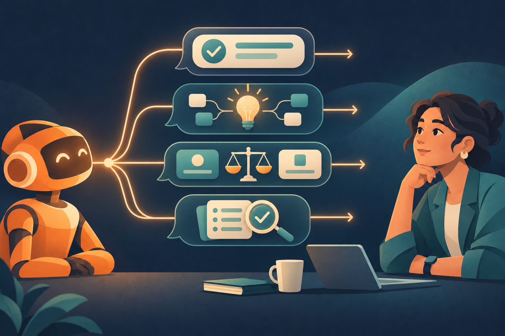

# Four Ways Humans Receive Help from AI



> An AI response can be an answer, an explanation, a recommendation, or a supporting lead. Those are not interchangeable.

Many AI conversations look similar on the surface.

A human types a prompt. The AI responds. The human asks a follow-up question.

It is tempting to describe all of them as question-and-answer exchanges. But that description is too shallow to explain what the resulting content means or how it should be reused.

Consider four situations:

1. I ask for the command that performs a specific operation.
2. I ask AI to teach me why that command works.
3. I ask which of three approaches I should choose.
4. I am writing an article and ask AI to locate information I still need to verify.

In each case, information moves from AI to Human.

But the Human and AI are playing different roles.

That creates four different conversation forms: **Inquiry, Learning, Advisory, and Assistance**.

---

## 1. Inquiry: Human as Questioner, AI as Answerer

Inquiry begins with a bounded question.

The Human wants an answer, clarification, definition, command, date, or specific explanation. The AI's primary role is to respond directly.

Typical outputs include:

- the original question;
- the direct answer;
- clarifications;
- qualifications;
- and follow-up questions created by the answer.

The reusable value is often straightforward. Repeated questions can become a personal FAQ. Operational answers can become a quick-reference note. Related questions can be grouped into an index.

But inquiry has an important limit:

> Receiving an answer does not mean building an understanding.

If I ask for a command and copy it, I may complete the immediate task without learning the model behind it. That is not a failure. It simply means the conversation served an inquiry purpose.

The mistake is treating the resulting answer as if it represents a complete learning process.

---

## 2. Learning: Human as Learner, AI as Teacher

Learning changes the relationship.

The Human is no longer asking only for the result. The Human is trying to develop understanding.

That may require:

- explanations at different levels;
- examples and counterexamples;
- comparisons with familiar concepts;
- questions that expose misunderstanding;
- and repeated reformulation until the concept becomes usable.

The most valuable part of a learning conversation may not be the final explanation. It may be the sequence of confusion, correction, and clarification.

That sequence shows:

- which concepts were difficult;
- which analogy helped;
- where the learner made an incorrect assumption;
- and what remains unresolved.

When preserved, a learning conversation can become:

- a structured learning note;
- a set of review questions;
- flashcards;
- a concept map;
- or a list of knowledge gaps for the next session.

This is why Inquiry and Learning should not be collapsed into one category. Inquiry optimizes for obtaining an answer. Learning optimizes for changing the learner's mental model.

---

## 3. Advisory: Human as Decision-Maker, AI as Advisor

Advisory conversations are about choice.

The Human may ask:

- Which option fits this situation?
- What are the trade-offs?
- What risks should be considered?
- What would you recommend under these constraints?

The AI responds as an advisor, not as the owner of the decision.

Useful advisory content includes:

- candidate options;
- assumptions;
- applicable conditions;
- benefits and costs;
- risks;
- reasons for the recommendation;
- and uncertainties that could change the recommendation.

The conclusion alone is not enough.

If a record only says “choose option B,” it becomes difficult to revisit when the context changes. A reusable advisory record needs to preserve why B was preferred, which conditions mattered, and what evidence was missing.

That material can later become:

- a decision matrix;
- an architecture decision record;
- a product comparison;
- or a review of whether the adopted recommendation produced the expected result.

AI can generate options and reasoning. Human still decides which constraints are real, which risks are acceptable, and who owns the result.

---

## 4. Assistance: Human as Primary Worker, AI as Supporting Assistant

Assistance is different from advisory work because the primary task already belongs to the Human.

The Human may be writing, researching, debugging, designing, or reviewing. AI is asked to perform a supporting operation:

- locate a possible source;
- compare two definitions;
- check whether a statement is internally consistent;
- identify missing information;
- verify a calculation;
- or produce a small intermediate artifact.

The output serves another task. It is not necessarily a final answer or decision.

This makes status especially important.

An AI-provided citation may be a lead, not a verified source. A comparison may be preliminary. A claimed fact may still require a primary source. A calculation may need independent checking.

A reusable assistance record should therefore preserve:

- what was requested;
- why it was needed;
- what AI returned;
- what was checked;
- what remains unverified;
- and how the result was used in the main task.

Zotero may later hold the actual publication. A spreadsheet may hold the verified comparison. The topic record preserves why the search happened and how the result affected the work.

---

## The Same Sentence, Four Different Meanings

Suppose AI says:

> This approach has three major risks.

In an Inquiry conversation, that sentence may be the direct answer to “What are the risks?”

In a Learning conversation, it may introduce concepts the Human needs to understand.

In an Advisory conversation, the risks may become reasons to reject an option.

In an Assistance conversation, they may be preliminary leads that still need evidence.

The words are the same.

Their status is not.

---

## Record the Relationship, Then Reuse the Content

This distinction changes what should happen after export.

```text
Inquiry
→ FAQ or answer index

Learning
→ notes, review questions, knowledge gaps

Advisory
→ decision matrix, rationale, outcome review

Assistance
→ source trail, verification list, supporting material
```

The conversation record does not perform those transformations automatically. It preserves the material and context so the appropriate downstream work remains possible.

That is the practical value of identifying the conversation form.

Before reusing an AI response, ask:

> Was this intended as an answer, an explanation, a recommendation, or a supporting lead?

The answer determines what the content means—and what must happen before it can be trusted or used again.

Chat Record Reuse · 02 / 10

#ArtificialIntelligence #Learning #DecisionMaking #Research #KnowledgeWork
