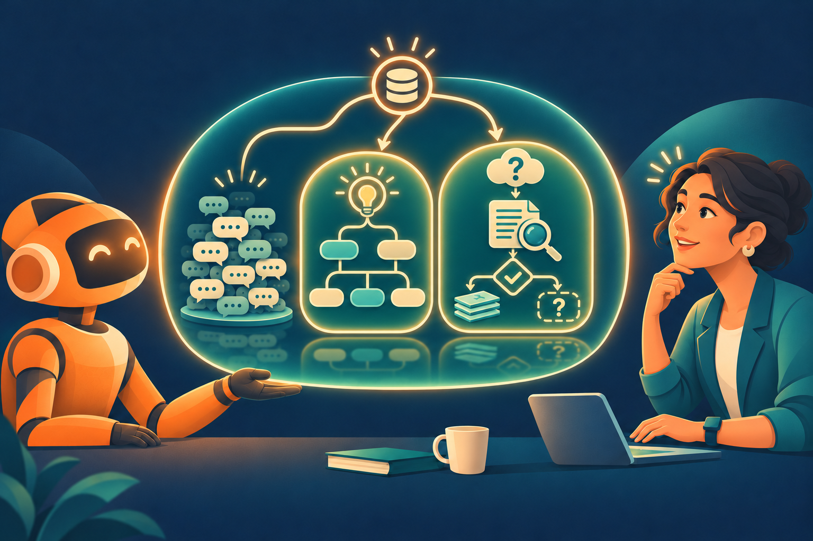

# Reuse AI Conversations for Learning and Research



> A recorded conversation is not yet a knowledge base or a verified source. It is material that can enter both.

AI conversations have become part of how many people learn and research.

We ask for an explanation, compare concepts, test an interpretation, request examples, locate possible sources, and discover questions we did not know to ask.

Then the chat ends.

The learning is fragmented across messages. The research leads are mixed with AI-generated interpretation. Some statements are useful. Some are wrong. Some are plausible but still unverified.

The solution is not to treat the transcript as finished knowledge.

The solution is to give each tool a clear responsibility.

---

## Layer 1: Topic Chat Recorder Preserves the Interaction

The recorder's role is capture.

It preserves the selected user and assistant messages, the topic, and basic session metadata in Markdown.

For a learning or research conversation, this can retain:

- the original questions;
- explanations that were useful;
- misunderstandings and corrections;
- comparisons;
- research leads;
- unresolved questions;
- and statements that still require verification.

The exported record should not silently convert all of these into facts.

It preserves what happened in the conversation.

That is the starting point.

---

## Layer 2: Obsidian Organizes Long-Term Understanding

Plain Markdown makes it possible to place a topic record inside an [Obsidian vault](https://help.obsidian.md/Getting+started/Create+a+vault) without converting it into a proprietary format.

The raw record can remain intact while separate notes capture what the Human has concluded.

For example:

```text
conversation-record-reuse.md      ← original topic record
conversation-types.md             ← organized concepts
unverified-claims.md              ← verification backlog
article-ideas.md                   ← possible outputs
```

Links can connect the record to related concepts. Tags can mark status. A topic index can show which questions are open, which sources have been verified, and which notes have become stable enough to reuse.

This separation is valuable:

```text
Raw conversation
≠
Human-maintained knowledge note
```

The first preserves context. The second expresses the Human's current understanding.

Editing the original transcript until it looks like a clean note destroys that distinction. A better approach is to preserve the record and derive new notes from it.

---

## Layer 3: NotebookLM Questions a Selected Source Set

When several topic records relate to the same subject, NotebookLM can be used as a source-grounded research workspace.

Possible questions include:

- What conclusions recur across these discussions?
- Which questions remain unresolved?
- Where do two sessions contradict each other?
- Which assumptions changed over time?
- What material could support a study guide or briefing?

Google describes [NotebookLM](https://support.google.com/notebooklm/answer/16164461?hl=en) as working from selected sources and providing citations back to them. That makes it useful for navigating a bounded collection.

But the boundary remains important:

> A citation to a conversation proves that the statement appeared in the conversation. It does not prove that the statement is true.

If the source contains an incorrect AI answer, source-grounded synthesis can faithfully reproduce that incorrect answer.

NotebookLM improves navigation and synthesis. It does not eliminate source verification.

---

## Layer 4: Zotero Manages External Evidence

Research needs a place for actual publications, authors, dates, identifiers, PDFs, notes, and source metadata.

That is a different responsibility from preserving an AI conversation.

[Zotero](https://www.zotero.org/support/quick_start_guide) can hold:

- journal articles;
- books;
- reports;
- web pages;
- source notes;
- collections;
- and tags.

The topic record can explain why a source was sought and how it affected the discussion. Zotero can preserve the source itself and its bibliographic context.

```text
Topic record
  Why did this source matter?
  Which claim was being investigated?
  How did it change the discussion?

Zotero
  What is the source?
  Who created it?
  Where is the publication or attachment?
```

Neither tool should pretend to be the other.

---

## A Practical Learning Workflow

Suppose I use AI to learn a technical concept.

The conversation includes a simple explanation, an analogy, a detailed example, two corrections, and three questions I still cannot answer.

After recording:

1. Keep the topic Markdown as the original interaction record.
2. Create a separate Obsidian note explaining the concept in my own structure.
3. Convert unresolved points into a learning backlog.
4. Add verified external sources to Zotero.
5. Add several related topic records to NotebookLM for comparison.
6. Generate review questions, then answer them without looking at the source.

The valuable output is not “AI explained the concept.”

It is a visible learning state:

```text
Understood
Partially understood
Misunderstood and corrected
Still unresolved
Requires external verification
```

---

## A Practical Research Workflow

Research conversations require stronger boundaries.

```text
Record
  Preserve the research question and AI interaction

Extract
  Separate claims, leads, interpretations, and questions

Verify
  Locate and read primary or authoritative sources

Organize
  Store source metadata and notes

Synthesize
  Compare verified evidence across the selected collection

Write
  Produce a claim with appropriate support and limits
```

The record is useful because it shows the path from question to investigation.

It is not a substitute for the investigation.

---

## Preserve Learning Without Confusing It with Truth

AI conversations can contain genuine intellectual value:

- the question that opened a new direction;
- the analogy that made a concept understandable;
- the contradiction that exposed a weak assumption;
- the list of sources that still need review;
- and the evolution of the learner's understanding.

That value should not disappear when the chat ends.

But preserving it responsibly requires status.

What did the conversation say?

What does the Human currently understand?

What has been verified externally?

What remains uncertain?

Topic Chat Recorder preserves the first layer. Obsidian, NotebookLM, and Zotero can help develop the others.

**Capture the conversation. Continue the learning elsewhere.**

Chat Record Reuse · 07 / 10

#ArtificialIntelligence #Research #Learning #Obsidian #NotebookLM
