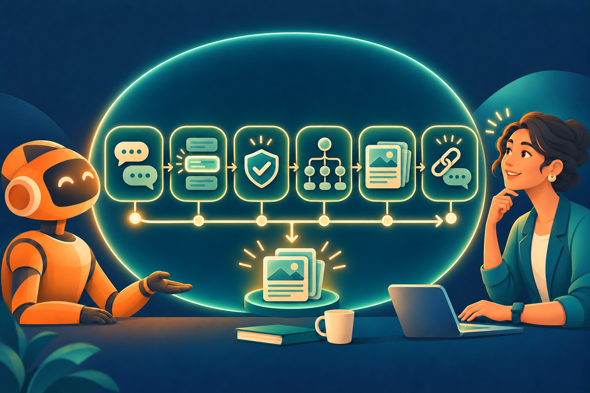

# From One AI Discussion to a Reusable Knowledge Asset



> This series did not begin as a content plan. It began as a question inside an AI conversation.

The question was simple:

> When people use AI for learning and writing, what kinds of conversations do they have?

An initial list appeared: learning, discussion, analysis, critique, advice, review, assistance, and inquiry.

That list could have become a note and ended there.

Instead, the conversation itself demonstrated why chat records can matter.

The categories were challenged. “Assistance” was clarified. Additional forms were considered. The classification was reorganized according to Human–AI roles. The topic expanded into reuse workflows, product positioning, publishing structure, and a Capafy description.

This is the path from one discussion to a reusable knowledge asset.

---

## Stage 1: An Initial Classification

The first classification treated several dimensions as if they were equivalent.

Some items described a Human purpose:

- learning;
- analysis;
- creation.

Some described the role assigned to AI:

- advisor;
- reviewer;
- assistant.

Some described the interaction pattern:

- inquiry;
- discussion.

The list was useful, but its foundation was inconsistent.

The conversation improved when the categories were reframed around a single question:

> What roles are Human and AI playing in relation to each other?

That produced twelve forms grouped into four directions:

```text
Human receives from AI
  Inquiry, Learning, Advisory, Assistance

Human and AI develop together
  Discussion, Exploration, Analysis, Creation

AI evaluates or challenges Human
  Critique, Review, Dialectic

AI helps Human look back
  Reflection
```

The value was not merely a longer list. The new structure explained why each form produced content with a different status.

---

## Stage 2: Clarifying Assistance

At one point, “Assistance” was interpreted too broadly as helping complete a task.

The intended meaning was narrower: supporting lookup, verification, and related work while the Human remained responsible for the primary task.

That correction changed the model.

Assistance was no longer a generic bucket for everything AI helps with. It became a specific relationship:

```text
Human: primary worker
AI: supporting researcher or checker
Output: leads, comparisons, verification results, unresolved items
```

This made its reuse path clearer. The output belongs in a research trail or verification backlog, not automatically in the final artifact.

Without the conversation record, the final definition would survive while the reason for changing it would disappear.

---

## Stage 3: From Classification to Reuse

The next question was practical:

> If these forms produce different content, how can the records be reused?

The classification connected to downstream outputs:

- inquiry became FAQs;
- learning became notes and review questions;
- advice and analysis became decision records;
- exploration became research questions;
- creation became articles and other artifacts;
- review became issues and checklists;
- dialectic became stronger claims;
- reflection became retrospectives and lessons.

Then tools entered the model:

- Obsidian for connected notes;
- NotebookLM for source-grounded questioning across selected records;
- Zotero for actual external sources;
- spreadsheets for comparisons;
- issue trackers for actionable findings;
- Git for artifact history.

This clarified an important product boundary.

Topic Chat Recorder did not need to become a knowledge-management platform. Its job was to create portable upstream material.

---

## Stage 4: From Product Idea to Accurate Description

The product description originally emphasized structured, auditable records and decision provenance.

Those phrases risked suggesting more than the implementation could guarantee.

The conversation returned to actual behavior:

- read the local Codex or Claude Code transcript;
- capture user and assistant text;
- allow full-task or start-and-stop export;
- include session metadata and trace IDs;
- write local Markdown;
- exclude system, developer, reasoning, and tool content.

From those facts, a more accurate position emerged:

> Capture the conversation. Reuse the knowledge anywhere.

The details page could explain Obsidian and NotebookLM as downstream workflows without claiming built-in integration.

It could describe traceability without calling the file tamper-proof.

It could describe process history without claiming authorship proof.

The record helped preserve not only the marketing language, but why its boundaries mattered.

---

## Stage 5: From Discussion to a Publishing System

The topic then became a content plan.

Medium would hold complete arguments and workflows.

LinkedIn would include two Articles and independent Posts.

X would use long Articles for complete models and many short Posts for distinctions, questions, and counterexamples.

The current series emerged from that plan.

This created an unusual but useful loop:

```text
AI conversation
     ↓
topic record
     ↓
classification model
     ↓
product description
     ↓
content plan
     ↓
article explaining the reuse of the original conversation
```

The topic record became both source material and case evidence.

---

## What the Record Did—and Did Not—Provide

The record provided:

- the sequence of ideas;
- the definitions that changed;
- the Human corrections;
- the branches that appeared;
- the product boundaries that were accepted;
- and the material used to create later artifacts.

It did not prove:

- that every AI statement was correct;
- that the classification is universally complete;
- that the Human owns every legal right associated with later text;
- or that the exported Markdown was cryptographically protected.

The record was useful without needing to make those stronger claims.

---

## The Reuse Test

The value of a conversation record can be tested with practical questions:

- Could a later session continue without reconstructing all the background?
- Could the Human find why a definition or decision changed?
- Could unfinished branches be identified?
- Could selected material become a formal artifact?
- Could the artifact retain a path back to its source context?

For this topic, the answer was yes.

One conversation did not become “knowledge” merely because it was saved.

It became a reusable asset because the record was selected, reorganized, checked against implementation, and transformed into new work.

That is the distinction:

> **Recording preserves possibility. Reuse realizes the value.**

Topic Chat Recorder preserves selected Codex and Claude Code conversations as topic-based, reusable Markdown. It is the recording layer used at the beginning of this workflow—not a replacement for Human selection, verification, or transformation.

[View Topic Chat Recorder in the marketplace](https://capafy.ai/zh-hant/agent/topic-chat-recorder)

Chat Record Reuse · 09 / 10

#ArtificialIntelligence #KnowledgeManagement #ContentStrategy #ProductDevelopment #AIAssistants
